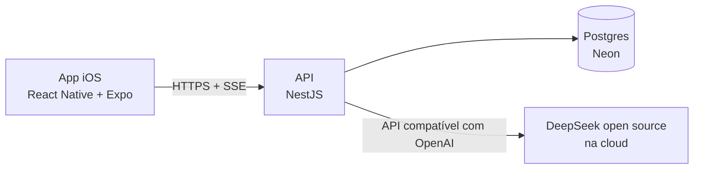

# Roamind

**Um chat de IA pessoal com liberdade de escolha.** O Roamind é um app para iPhone no estilo ChatGPT em que você conversa com modelos de IA abertos, escolhe qual modelo usar e mantém suas conversas sob seu controle.

> 🚧 Em construção. Veja [Estado atual](#estado-atual).

## Por que o Roamind

- **Liberdade de modelo:** em vez de ficar preso a um modelo e às regras dele, você usa modelos abertos e pode trocar entre eles.
- **Suas conversas, seus dados:** o histórico fica no seu backend e no seu banco, não na plataforma de outra empresa.
- **Experiência de chat de verdade:** respostas em tempo real, histórico organizado e controle sobre o comportamento do assistente.

## Funcionalidades

### Primeira versão
- Login com email e senha
- Respostas em streaming, aparecendo palavra por palavra
- Histórico de conversas: listar, abrir e apagar
- Prompt de sistema para ajustar o tom e a personalidade do assistente
- Parar a resposta, regenerar a última e copiar o texto
- Um modelo, configurado no backend

### Próximos passos
- Escolha do modelo no app, a partir de uma lista curta de modelos selecionados
- Memória entre conversas
- Voz: falar e ouvir as respostas
- Anexos de imagens e arquivos
- Recuperação de senha
- Criptografia do conteúdo das mensagens
- Versão web

## Arquitetura (Em revisão)

O app nunca fala direto com o provedor de IA. Toda conversa passa pela API, que autentica o usuário, salva as mensagens e repassa a resposta do modelo em streaming.



| Camada | Tecnologia |
| --- | --- |
| App | React Native com Expo e Expo Router |
| API | NestJS, com streaming via SSE |
| Autenticação | JWT (access e refresh token) e senhas com argon2 |
| Banco | Postgres no Neon, com Drizzle |
| Hospedagem da API | Render |
| Modelo | DeepSeek open source, hospedado na cloud |
| Monorepo | pnpm workspaces e Turborepo |

### Estrutura

```
apps/
  backend/      # API em NestJS
  mobile/       # App em Expo
packages/
  shared/       # tipos e schemas compartilhados
  api-client/   # cliente da API usado pelo app
```

### Modelos

- Modelo inicial: DeepSeek open source, rodando na cloud e acessado por uma API compatível com a da OpenAI
- A chave da API fica só no backend, nunca no app
- O backend usa uma interface de provedor, então dá para trocar de modelo ou de provedor sem mexer no resto do sistema

## Estado atual

Em construção, ainda não roda. Nesta fase, trocar de modelo significa mudar uma variável de ambiente no backend e fazer deploy.

## Como rodar

O passo a passo entra aqui quando o backend estiver de pé. Até a distribuição pelo TestFlight, o app abre pelo Expo Go.
