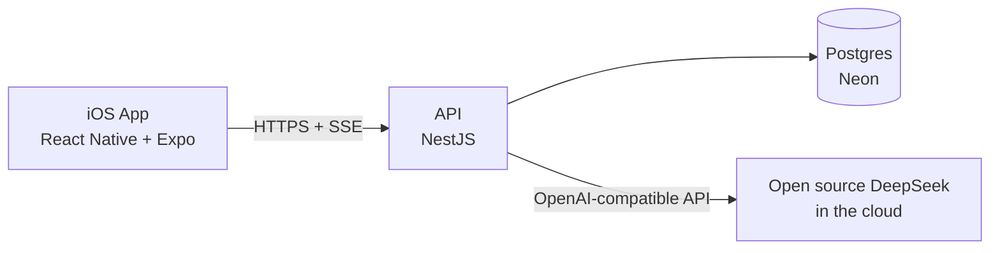

# Roamind

**A personal AI chat with freedom of choice.** Roamind is a ChatGPT-style iPhone app where you chat with open-source models, choose which model to use, and keep your conversations under your control.

> 🚧 Under construction. See [Current status](#current-status).

## Why Roamind

- **Model freedom:** instead of being locked into one model and its rules, you use open models and can switch between them.
- **Your conversations, your data:** your history lives on your own backend and database, not on another company's platform.
- **A real chat experience:** real-time responses, organized history, and control over how the assistant behaves.

## Features

### First version

- Email and password login
- Streaming responses, appearing word by word
- Conversation history: list, open, and delete
- System prompt to adjust the assistant's tone and personality
- Stop a response, regenerate the last one, and copy the text
- A single model, configured on the backend

### Next steps

- Model selection in the app, from a short list of curated models
- Memory across conversations
- Voice: speak and listen to responses
- Image and file attachments
- Password recovery
- Message content encryption
- Web version

## Architecture (Under review)

The app never talks directly to the AI provider. Every conversation goes through the API, which authenticates the user, stores the messages, and streams the model's response back.



| Layer          | Technology                                                  |
| -------------- | ----------------------------------------------------------- |
| App            | React Native with Expo and Expo Router                      |
| API            | NestJS, with SSE streaming                                  |
| Authentication | JWT (access and refresh tokens) and argon2 password hashing |
| Database       | Postgres on Neon, with Drizzle                              |
| API hosting    | Render                                                      |
| Model          | Open-source DeepSeek, hosted in the cloud                   |
| Monorepo       | pnpm workspaces and Turborepo                               |

### Structure

```
apps/
  backend/      # NestJS API
  mobile/       # Expo app
packages/
  shared/       # shared types and schemas
  api-client/   # API client used by the app
```

### Models

- Initial model: open-source DeepSeek, running in the cloud and accessed through an OpenAI-compatible API
- The API key lives only on the backend, never in the app
- The backend uses a provider interface, so the model or provider can be swapped without touching the rest of the system

## Current status

Under construction, not runnable yet. At this stage, switching models means changing an environment variable on the backend and redeploying.

## Getting started

Setup steps will be added here once the backend is up. Until it's distributed through TestFlight, the app runs on Expo Go.
